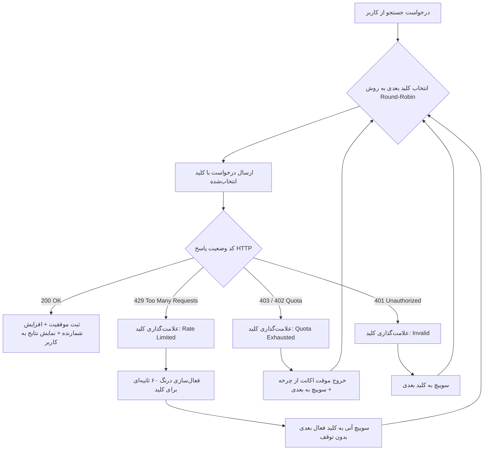

# مستند جامع و کانتکس فنی پروژه Consensus PaperCraft Studio

> این سند برای آشنایی کامل همکاران، توسعه‌دهندگان و پژوهشگران همکار با تمامی جزئیات، معماری، منطق فنی و نحوه کاربری پروژه **Consensus PaperCraft Studio** تدوین شده است.

---

## ۱. خلاصه اجرایی پروژه (Executive Summary)

* **نام پروژه:** Consensus PaperCraft Studio (استودیو نگارش مقاله با موتور کانسنسوس)
* **آدرس مخزن:** `https://github.com/m-naeim-m/consensus-papercraft`
* **هدف اصلی:** ایجاد یک پلتفرم جامع دانشگاهی برای **کاوش شواهد علمی، استخراج دستاوردهای کلیدی، ساخت ماتریس مرور ادبیات و نگارش خودکار فصول مقاله پژوهشی** با تکیه بر پایگاه رسمی [Consensus.app](https://consensus.app) (شامل بیش از ۴۰۰ میلیون مقاله داوری‌شده بین‌المللی).
* **نوآوری محوری:** پیاده‌سازی یک **موتور بالانسر هوشمند (Load Balancer & Failover)** جهت توزیع خودکار درخواست‌ها بین چندین حساب کاربری Consensus و سوییچ خودکار در زمان ریت‌لیمیت یا اتمام سهمیه ماهانه.

---

## ۲. مسئله اصلی و راه‌حل ارائه‌شده (Problem & Solution)

### چالش:
1. استفاده از موتورهای هوش مصنوعی دانشگاهی مثل Consensus مستلزم API Key است.
2. پلن‌های رایگان یا پایه Consensus محدودیت‌هایی دارند:
   - سقف نرخ درخواست: معمولاً **۱ درخواست در ثانیه (Rate Limit: 1 req/sec)**
   - سهمیه ماهانه: معمولاً ۳۰ جستجو در ماه برای هر اکانت
3. در حالت عادی، اگر کاربر چندین اکانت داشته باشد، تغییر دستی کلیدها پس از هر چند درخواست یا هنگام خطای ریت‌لیمیت (HTTP 429) کاری فرسایشی، کند و خطاست.

### راه‌حل پیاده‌سازی‌شده در این پروژه:
یک استخر کلیدهای پویا (Key Pool) ساخته شده که:
- درخواست‌های جستجو را به صورت چرخشی (**Round-Robin**) میان تمام اکانت‌های فعال پخش می‌کند.
- اگر اکانتی با خطای **۴۲۹ (Rate Limit)** روبرو شود، سیستم بدون ایجاد وقفه یا نمایش خطا به کاربر، آن اکانت را برای ۶۰ ثانیه وارد حالت استراحت (Cooldown) کرده و **همان لحظه با کلید سالم بعدی درخواست را مجدداً ارسال می‌کند**.
- اگر سهمیه ماهانه اکانتی پایان یابد (**HTTP 403/402**)، اکانت را از چرخه خارج کرده و کار را با بقیه اکانت‌ها ادامه می‌دهد.

---

## ۳. پشته فناوری (Technology Stack)

| لایه | ابزار / کتابخانه | هدف و کاربرد |
| :--- | :--- | :--- |
| **Backend** | Python 3.10+ / FastAPI | فریم‌ورک سبک و بسیار سریع ناهمگام (Async) برای مدیریت API و پردازش‌ها |
| **Server** | Uvicorn (ASGI) | اجرای سرور محلی با قابلیت بارگذاری مجدد (Reload) |
| **HTTP Client** | HTTPX (AsyncClient) | برقراری ارتباط پایدار، سریع و ناهمگام با سرورهای Consensus |
| **Data Validation** | Pydantic v2 | اعتبارسنجی دقیق مدل‌های داده‌ای ورودی و خروجی |
| **Word Export** | python-docx | تولید فایل‌های استاندارد Microsoft Word (.docx) با استایل علمی و فونت راست‌چین |
| **Citation Formats** | ماژول اختصاصی Exporter | تبدیل ارجاعات به فرمت‌های استاندارد EndNote (`.enw` و `.ris`) و APA / Vancouver |
| **Frontend** | Pure Vanilla JS / CSS3 / HTML5 | رابط کاربری مدرن (SPA)، بسیار سریع، بدون نیاز به بیلد یا پکیج‌های سنگین Node.js |
| **طراحی بصری** | CSS Variables + فونت وزیرمتن | پشتیبانی دوطرفه از Dark Mode / Light Mode و راست‌چین استاندارد فارسی |

---

## ۴. منطق بالانسر و چرخش کلیدها (Load Balancing & Failover Logic)



### ویژگی‌های کلیدی این بالانسر:
1. **Thread-Safe & Lock:** استفاده از قفل ناهمگام (`asyncio.Lock`) تا در درخواست‌های همزمان هیچ تداخلی رخ ندهد.
2. **ریکاوری خودکار (Auto-Recovery):** به محض گذشت ۶۰ ثانیه از خطای ۴۲۹ یک کلید، وضعیت آن به شکل خودکار به `active` برگشته و مجدداً وارد نوبت می‌شود.
3. **لاگ زنده:** تمام عملیات سوییچ و چرخش در تب «لاگ زنده» به صورت زمان‌بندی‌شده ثبت می‌شود.

---

## ۵. بخش‌ها و امکانات نرم‌افزار

### ۱. نگارش مقاله علمی (Paper Writer Studio)
- **پشتیبانی از ۲ زبان:** فارسی (ادبیات دانشگاهی استاندارد) و انگلیسی (Academic Standard).
- **سبک‌های ارجاع‌دهی:** APA 7th Edition، Vancouver (عددی) و IEEE.
- **تولید هوشمند فصول:**
  - چکیده (Background, Methods, Results, Conclusions, Keywords)
  - مقدمه و بیان مسئله (با ارجاعات درون‌متنی به مقالات کانسنسوس)
  - مرور مبانی نظری و ادبیات پژوهش
  - ماتریس تطبیقی مقالات (Literature Matrix Table)
  - مواد و روش‌های پژوهش (Methodology)
  - یافته‌ها و بحث نقادانه (Results & Discussion)
  - نتیجه‌گیری و افق‌های آینده
  - مراجع کامل با شناسه دیجیتال (DOI)
- **خروجی‌ها:** دانلود مستقیم فایل `.docx` (ورد)، فایل `.md` (مارک‌داون) و کپی مستقیم در کلیپ‌بورد.

### ۲. کاوش مقالات کانسنسوس (Consensus Search)
- جستجوی طبیعی در پایگاه مقالات (فارسی یا انگلیسی).
- فیلتر محدوده سال انتشار (مثلاً ۲۰۲۰ تا ۲۰۲۶).
- استخراج فیلدهای تخصصی:
  - **Consensus AI Takeaway:** دستاورد کلیدی که هوش مصنوعی کانسنسوس از مقاله خلاصه کرده است.
  - **SJR Quartile:** رتبه نشریه در پایگاه سایماگو (Q1, Q2, Q3, Q4).
  - **Study Design:** نوع مطالعه (کارآزمایی بالینی، مرور نظام‌مند، کوهورت و...).
  - **Sample Size:** حجم جامعه یا نمونه آماری مطالعه.
- دکمه تک‌کلیک جهت پین کردن مقاله به کتابخانه پژوهش.

### ۳. ماتریس ادبیات و ارتباط با نرم‌افزارهای رفرنس‌دهی
- تجمیع خودکار مقالات انتخاب‌شده در یک جدول مقایسه‌ای ماتریسی.
- **خروجی مستقیم به اندنوت:** تولید فایل‌های `.enw` و `.ris` برای وارد کردن مستقیم به EndNote، Zotero و Mendeley.

### ۴. مدیریت استخر کلیدها (API Key Pool)
- افزودن کلید به صورت تک‌تک همراه با تست سلامت زنده (Health Ping Test).
- افزودن همزمان چندین کلید با یک کادر متنی (Bulk Import).
- فعال/غیرفعال‌سازی موقت هر کلید با یک دکمه.
- دکمه ریست وضعیت کلیدها در ابتدای ماه میلادی (جهت احیای سهمیه‌ها).

### ۵. حالت آزمایشی (Demo Mode)
- برای زمانی که کاربر کلید واقعی ندارد یا می‌خواهد بدون سوزاندن سهمیه، جریان نگارش، خروجی ورد و کارکرد سیستم را به همکاران یا اساتید پرزنتیشن دهد.

---

## ۶. ساختار فایل‌های پروژه (Repository Layout)

```
consensus-papercraft/
│
├── backend/                        # ماژول‌های منطقی و سرویس‌های بک‌اند
│   ├── __init__.py
│   ├── models.py                   # مدل‌های Pydantic برای داده‌ها و کلیدها
│   ├── key_manager.py              # مدیریت استخر کلیدها، چرخش و بالانسر
│   ├── consensus_client.py         # کلاینت ارتباط با Consensus API و مدیریت ریت‌لیمیت
│   ├── paper_generator.py          # موتور ترکیب شواهد و نگارش فصول مقاله
│   ├── exporter.py                 # تبدیل و خروجی به Word (.docx) و اندنوت (.ris/.enw)
│   └── storage.py                  # ذخیره‌سازی محلی کتابخانه و پیش‌نویس‌ها
│
├── static/                         # رابط کاربری وب (Frontend SPA)
│   ├── index.html                  # صفحه اصلی شامل ۵ تب کاربردی
│   ├── style.css                   # طراحی مدرن، پشتیبانی دارک مود و فونت فارسی
│   └── app.js                      # کدهای منطقی فرانت‌اند و ارتباط با API
│
├── main.py                         # نقطه ورود برنامه و سرور FastAPI
├── start.py                        # لانچر خودکار پایتون با قابلیت باز کردن مرورگر
├── run.bat                         # اجرای سریع با دو بار کلیک در ویندوز
├── push_to_github.bat              # هماهنگ‌سازی و ارسال تغییرات به گیت‌هاب با یک کلیک
├── requirements.txt                # لیست پکیج‌های پیش‌نیاز
├── consensus_keys.example.json     # قالب نمونه برای قرار دادن کلیدهای API
├── test_system.py                  # تست‌های جامع یکپارچه‌سازی سیستم (۱۰۰٪ پاس‌شده)
└── README.md                       # راهنمای مختصر کاربری
```

---

## ۷. راهنمای شروع سریع برای همکار جدید (Quick Start)

اگر همکار جدید پروژه هستید، برای راه‌اندازی این نرم‌افزار روی سیستم خود کافیست ۳ گام زیر را انجام دهید:

### گام اول: کلون کردن پروژه
```bash
git clone https://github.com/m-naeim-m/consensus-papercraft.git
cd consensus-papercraft
```

### گام دوم: نصب پیش‌نیازها
مطمئن شوید پایتون روی سیستم‌تان نصب است، سپس دستور زیر را بزنید:
```bash
pip install -r requirements.txt
```

### گام سوم: اجرا
کافیست روی فایل **`run.bat`** دو بار کلیک کنید (یا در ترمینال دستور `python start.py` را بزنید). برنامه به طور خودکار در مرورگر در آدرس `http://127.0.0.1:8000` باز می‌شود.

### گام چهارم: ثبت کلیدها
در محیط وب به تب **«🔑 مدیریت استخر کلیدها»** بروید و کلیدهای Consensus خود را ثبت کنید. (اگر کلیدی ندارید، دکمه «🧪 حالت آزمایشی» را از بالای صفحه روشن کنید).

---

## ۸. نکات امنیتی و همکاری در گیت

1. **عدم انتشار کلیدها:** فایل `consensus_keys.json` در فایل `.gitignore` قرار داده شده و روی گیت‌هاب آپلود نمی‌شود تا امنیت حساب‌ها کاملاً حفظ گردد.
2. **ارسال تغییرات (Push):** پس از هرگونه توسعه یا اصلاح در کدها، با اجرای فایل `push_to_github.bat` تغییرات به آسانی به مخزن ارسال می‌شود.
3. **دریافت تغییرات همکار (Pull):** قبل از شروع کار در هر روز، اسکریپت فوق ابتدا آخرین تغییرات همکار دیگر را دریافت کرده و سپس کدهای جدید را ارسال می‌کند.
